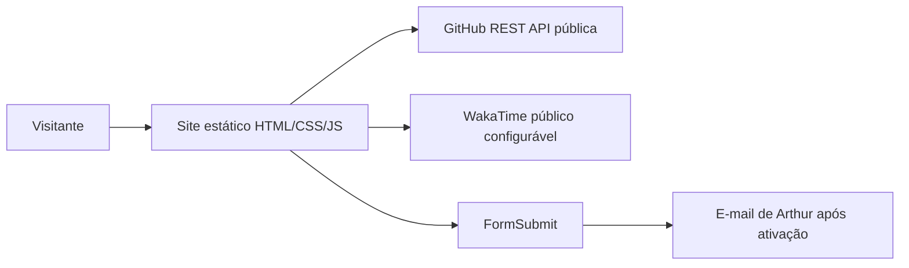
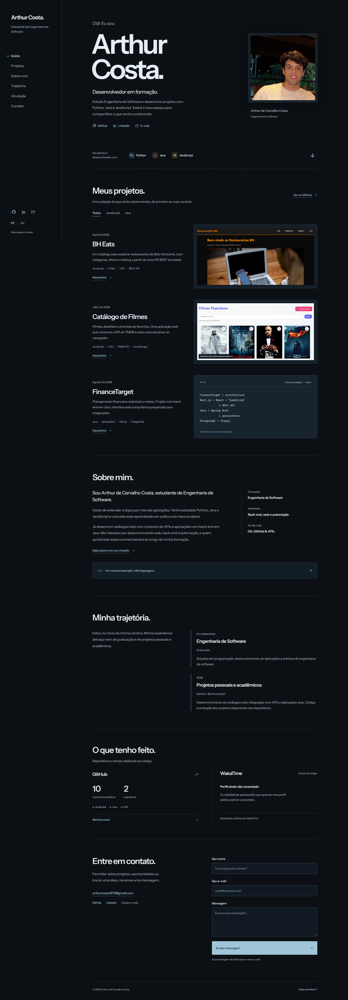
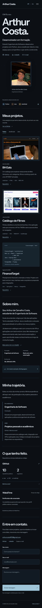

# Arthur Costa · Portfólio profissional

Portfólio de **Arthur de Carvalho Costa**, estudante de **Engenharia de Software**, com foco em **Python, Java e JavaScript**. Desenvolvido a partir dos requisitos do Laboratório 01 de DIAW. A apresentação prioriza nome, foto, trajetória e projetos, com navegação lateral, tema escuro e partículas interativas no fundo.

## Links úteis

- [Site na nuvem — acesso privado do proprietário](https://arthur-costa-portfolio.arquitetura542925.chatgpt.site)
- [GitHub](https://github.com/arthurcosta7)
- [Código do portfólio](https://github.com/arthurcosta7/portifolio)
- [LinkedIn](https://www.linkedin.com/in/arthur-costa-dev/)
- Contato: arthurcosta1973@gmail.com
- [Direção visual e wireframe](docs/design.md)

## Status

Interface implementada, responsiva e bilíngue. O formulário possui integração real com FormSubmit, mas a entrega de e-mail depende da ativação do destinatário. O WakaTime depende do usuário público de Arthur. A hospedagem inicial é privada; para apresentação pública acadêmica, publique a pasta `dist` no GitHub Pages ou altere explicitamente o acesso da hospedagem.

## Sobre o projeto

Apresenta formação, interesses, projetos em ordem cronológica, trajetória acadêmica e formas de contato. Os projetos foram conferidos nos repositórios públicos de Arthur. Experiências profissionais, empresas, datas de ingresso e métricas de produtividade não fornecidas não foram inventadas.

## Funcionalidades

- Português e inglês com preferência preservada no navegador.
- Caderno de código expansível na seção Sobre mim, com abas Python, Java e JavaScript e saída animada. É uma demonstração visual; não executa código arbitrário.
- Projetos ordenados do mais antigo ao mais recente, com filtros de linguagem e links reais.
- Trajetória acadêmica e projetos pessoais.
- Perfil e estatísticas públicas do GitHub pela API oficial, com tratamento de falha e limite de requisições.
- Integração configurável com WakaTime, com estado honesto quando desconectado.
- Formulário de contato validado com envio ao FormSubmit, indicadores de carregamento, falha e confirmação do serviço.
- Copiar e-mail, menu móvel, navegação por teclado e respeito a movimento reduzido.
- Rede de partículas em Canvas com reação ao cursor, retorno suave e conexões por proximidade. Até 90 partículas, renderização limitada a 30 fps e pausa com aba oculta.
- Entradas sequenciais de textos e imagens na rolagem, paralaxe discreta da foto no desktop e barra de progresso. Movimento reduzido desliga animações e mantém todo o conteúdo visível.

## Tecnologias e dependências

| Camada | Tecnologia |
| --- | --- |
| Interface | HTML semântico, CSS responsivo, JavaScript ES Modules |
| Fontes | Instrument Sans e IBM Plex Mono, via Google Fonts; sem cursiva |
| APIs públicas | GitHub REST API e WakaTime API |
| Envio de e-mail | FormSubmit, backend externo |
| Preview local | Node.js 22+ com módulos nativos `http`, `fs`, `path`, `url` |
| Hospedagem | Sites, arquivos estáticos |

Sem dependências npm de produção, sem framework, sem instalação obrigatória e sem processo de build. Python e Java são as linguagens de foco profissional, representadas na apresentação e no editor; a interface do portfólio é construída com HTML/CSS/JavaScript.

## Arquitetura



O site estático é portátil entre hospedagens e não armazena mensagens em banco de dados. O backend de e-mail é o FormSubmit. Nenhuma senha de e-mail ou chave privada é exposta no navegador. Dados de contato são enviados ao serviço externo apenas quando o visitante envia o formulário. O servidor Node serve exclusivamente o preview local.

## Instalação e execução

Pré-requisito: Node.js 22 ou superior.

```powershell
npm run dev
```

Abra [http://localhost:4173](http://localhost:4173). Não é necessário `npm install`. Para usar outra porta:

```powershell
$env:PORT = '4300'
npm run dev
```

Para verificar a sintaxe:

```powershell
npm run check
```

## Configuração do contato

O formulário está configurado para `arthurcosta1973@gmail.com`. O destinatário é público e não é uma credencial.

1. No site, envie uma mensagem de teste de sua autoria.
2. Abra o e-mail de ativação enviado pelo FormSubmit, verifique também a pasta de spam e confirme o destinatário.
3. Se o serviço pedir confirmação adicional para outra origem, confirme a origem publicada.
4. Envie uma nova mensagem e confira o recebimento real na caixa de entrada.

O formulário não mostra uma confirmação de entrega na caixa de entrada: mostra a aceitação reportada pelo serviço. A primeira confirmação exige ação do proprietário e não foi executada pelo agente. Os testes automatizados interceptam a chamada para cobrir estados de sucesso, falha e ativação sem enviar mensagens reais.

O serviço oferece filtragem de spam; há também um campo honeypot. Consulte a [documentação do FormSubmit](https://formsubmit.co/documentation) para limites e comportamento do serviço. Os contatos diretos por e-mail e LinkedIn permanecem disponíveis em caso de indisponibilidade.

## WakaTime

Edite `dist/config.js`:

```js
wakatime: 'SEU_USUARIO_PUBLICO'
```

Ative o compartilhamento público das estatísticas no WakaTime. A integração lê `https://wakatime.com/api/v1/users/USUARIO/stats/last_7_days` e mostra total e linguagens quando a resposta pública é acessível pelo navegador. Perfil privado, bloqueio CORS ou indisponibilidade exibem um link para o perfil; nenhum valor é simulado. Não coloque a API key privada do WakaTime em `config.js`.

## Estrutura

```text
.openai/hosting.json      Identidade da hospedagem e pasta publicada
dist/
  index.html             Estrutura e conteúdo inicial
  style.css              Design e responsividade
  app.js                 Traduções, filtros, integrações e formulário
  motion.js              Partículas, entradas e progresso da rolagem
  motion.css             Camada visual de animação
  config.js              Configuração pública
  favicon.svg            Marca do portfólio
  assets/                Imagens dos projetos
docs/
  design.md              Direção visual e wireframe textual
  screenshots/           Capturas do portfólio
scripts/
  serve.mjs              Preview local sem dependências
  verify.cjs             Verificações de interface com Playwright
  verify-motion.cjs      Verificação de partículas e movimento reduzido
package.json
README.md
```

## Demonstração e imagens





- BH Eats: imagem original do repositório `public/images/printSite1.png`.
- Catálogo de Filmes: captura da interface real do repositório, carregada com dados demonstrativos para a apresentação. A versão pública do projeto requer uma chave TMDB própria. A legenda identifica os dados demonstrativos.
- FinanceTarget: diagrama visual da stack verificada no README, identificado como visão técnica. Uma screenshot do aplicativo em execução ainda precisa substituir essa visão para atender integralmente ao item de demonstração por projeto do laboratório.
- Foto: imagem enviada por Arthur, armazenada localmente em `dist/assets/arthur-costa.png`.

## Deploy

A aplicação publica diretamente os arquivos de `dist/`; não precisa de build. O arquivo `.openai/hosting.json` identifica a hospedagem Sites. A primeira versão tem acesso privado do proprietário. O link privado não atende sozinho à avaliação pública do laboratório.

Para publicar gratuitamente com GitHub Pages: envie o código ao repositório, configure uma ação que envie a pasta `dist` como artefato do Pages e publique na raiz de um domínio ou subdomínio próprio. Os caminhos de assets começam com `/`, portanto um Pages de projeto em `/portifolio/` exige trocar esses caminhos pelo prefixo do projeto. Outra opção é publicar `dist` na raiz de um serviço de hospedagem estática.

## Testes

Verificação de sintaxe: `npm run check`.

Os testes de interface em `scripts/verify.cjs` usam Playwright como ferramenta de desenvolvimento externa. Para executá-los, disponibilize o pacote e o Chromium no ambiente e rode o script enquanto o servidor local estiver ativo. O pacote não é necessário para executar ou hospedar o portfólio.

Cobertura: alternância de idioma, caderno expansível, abas do editor por clique e teclado, exemplo de execução, filtros, navegação móvel, ausência de rolagem horizontal em sete larguras (320 a 1440 px), imagens, validação de formulário e respostas simuladas do serviço de contato. Entrega real de e-mail e dados WakaTime permanecem dependentes de configuração externa.

`scripts/verify-motion.cjs` verifica pixels efetivamente desenhados no Canvas, iluminação em resposta ao cursor, entrada de projetos durante rolagem, barra de progresso, ausência de cursiva, tema escuro e pausa/retomada ao alterar a preferência de movimento reduzido.

## Pendências para a entrega acadêmica completa

- Informar o usuário público do WakaTime e verificar dados reais.
- Ativar o FormSubmit e conferir a entrega real de uma mensagem.
- Confirmar instituição e período do curso se desejar detalhá-los na trajetória.
- Incluir uma captura real do FinanceTarget em execução.
- Criar o protótipo no Figma, se exigido na Sprint 01. O wireframe textual não é apresentado como um arquivo Figma.
- Disponibilizar uma hospedagem de acesso público para avaliação. A versão na hospedagem Sites tem acesso privado do proprietário; o código está no repositório GitHub indicado acima.

## Autor e referências

Arthur de Carvalho Costa — Engenharia de Software.

Documentação adaptada ao [template do Prof. João Paulo Aramuni](https://github.com/joaopauloaramuni/desenvolvimento-e-integracao-de-aplicacoes-web/blob/main/TEMPLATES/template_README.md). Referências: [GitHub API](https://docs.github.com/en/rest), [WakaTime API](https://wakatime.com/developers), [FormSubmit](https://formsubmit.co/documentation), [MDN](https://developer.mozilla.org/).
